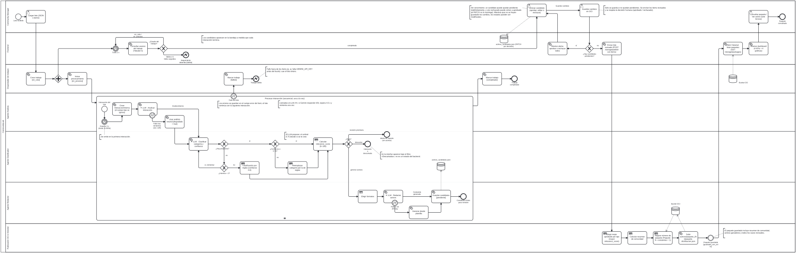

# CommunityLab · Grupo 10 · Equipo 23

CommunityLab convierte las conversaciones de una comunidad de aprendizaje (Discord, CSV, formularios, GitHub) en **activos de comunicación listos para publicar**: posts de LinkedIn, destacados para el newsletter semanal y sugerencias de FAQ. Agentes con LLM (Google Gemini) analizan, clasifican y redactan; una persona revisa y aprueba cada pieza, y el paquete final se guarda en **OCI Object Storage**.

**Demo en vivo (OCI Always Free)**

| Servicio | URL |
| --- | --- |
| Aplicación web (bandeja de revisión, historial y dashboard) | <http://138.2.245.128:3000/> |
| API y documentación interactiva (Swagger) | <http://164.152.246.126:8000/docs> |

---

## Pipeline completo



> Diagrama BPMN editable: [docs/FlujoCommunityLab.bpmn](docs/FlujoCommunityLab.bpmn) (se abre en <https://demo.bpmn.io> o Camunda Modeler).
> En el diagrama, **✦ LLM** marca las decisiones que toma un modelo, ⚙ las tareas de sistema, 📋 las reglas deterministas y 👤 las decisiones humanas.

1. **Carga del lote.** El Community Manager sube un JSON (hasta 500 interacciones). El backend crea un trabajo en segundo plano (`en_cola` → `en_proceso` → `completado` / `fallido`) y la interfaz consulta su avance cada 2 s, mostrando cada interacción apenas termina.
2. **Procesamiento por interacción**, una a la vez, con una pausa de 3 s entre interacciones para respetar la cuota de Gemini. Si Gemini responde 429, se espera 4.5 s y se reintenta una vez.
   - **Equipo A · ✦ Agente Analista:** extrae sentimiento (-1 a 1), temas, entidades, resumen e intención. Si falla, usa un análisis neutral marcado `degradado` y el flujo continúa. El campo `tipo` de la fuente nunca se usa para clasificar.
   - **Equipo B · ✦ Agente Clasificador (LangGraph):** propone una categoría con su confianza. Si no responde tras 2 intentos, o si su confianza es menor a **0.75**, se usa la categoría del clasificador por reglas. Luego calcula el `relevance_score` (0–100) y decide la ruta: generar activos, alerta de soporte o descartar.
   - **Equipo C · ✦ Agente Redactor:** según la categoría elige los formatos (éxito, testimonio o post social → LinkedIn + Newsletter; FAQ o contenido educativo → FAQ + LinkedIn) y los redacta usando solo hechos del análisis. Si el LLM falla, usa plantillas. Todo candidato nace `pendiente`.
3. **Revisión humana (HITL).** Cada candidato se aprueba, se edita y aprueba, o se rechaza. "Guardar cambios" queda bloqueado mientras quede alguno `pendiente`.
4. **Equipo D · Publicación.** Por cada formato oficial gana el candidato **aprobado** con mayor `relevance_score`. Se calcula el resumen de la comunidad y el paquete se guarda en OCI como `activos/paquete_{N}/paquete-distribucion.json`.
5. **Historial y dashboard.** La interfaz lista los paquetes guardados, muestra 4 KPIs y 4 gráficas (sentimiento, activos por canal, temas y relevancia) y permite inspeccionar cada caso en modo de solo lectura.

Un error en cualquier fase queda registrado en el campo `error` de esa interacción y **no detiene el resto del lote**.

## Arquitectura y stack

Monolito modular: las fases del pipeline son módulos de un único backend, no microservicios.

| Capa | Tecnología |
| --- | --- |
| Frontend | Next.js 15 (bandeja HITL, historial, dashboard) con rutas BFF `/api/*` que actúan de proxy hacia la API |
| Backend | FastAPI + Pydantic v2, LangChain + LangGraph |
| LLM | Google Gemini vía `langchain-google-genai` (recomendado `gemini-3.5-flash-lite`) |
| Persistencia | OCI Object Storage (paquetes finales); JSON local para candidatos en revisión |
| Infraestructura | Docker Compose; 2 VMs `VM.Standard.E2.1.Micro` de OCI Always Free (región `sa-vinhedo-1`) |

## Inicio rápido (local)

Requisitos: Docker Desktop con Docker Compose v2 y una clave de Gemini.

```bash
cp .env.example .env          # completa GEMINI_API_KEY
docker compose up --build     # backend en :8000 y frontend en :3000
```

- Aplicación: <http://localhost:3000> · API: <http://localhost:8000/docs> · Salud: `curl http://localhost:8000/health`
- **Sin credenciales de OCI** el backend usa un almacenamiento local equivalente (`backend/data/oci_mock/`), así que guardar paquetes e historial funcionan igual en desarrollo.
- **Sin `GEMINI_API_KEY`** la API arranca, pero los lotes terminan en `fallido`.
- El `.env` se lee al crear el contenedor: después de cambiarlo, ejecuta `docker compose up -d --force-recreate backend`.
- **Cuota de Gemini:** el límite gratuito es por proyecto y por modelo, y cada interacción consume de 3 a 5 solicitudes. Usa `GEMINI_MODEL=gemini-3.5-flash-lite` y consulta tus límites en <https://ai.dev/rate-limit>.

## Guía de despliegue en OCI

Arquitectura de dos capas: una VM para el frontend (puerto 3000), otra para el backend (puerto 8000) y un bucket de Object Storage.

### 1. Preparar OCI (una sola vez)

1. Crea el bucket (por defecto `communitylab-activos-marketing`).
2. Crea dos instancias `VM.Standard.E2.1.Micro` con Oracle Linux 9.
3. En la **Security List** de la VCN, agrega reglas de ingreso TCP desde `0.0.0.0/0`: puerto `3000` para el frontend y `8000` para el backend.
4. En tu usuario (Perfil → API Keys → Add API Key) genera una clave y descarga la clave privada (`.pem`) y el fragmento de configuración.

### 2. Preparar cada VM

```bash
# Docker, Compose y Git
sudo dnf config-manager --add-repo https://download.docker.com/linux/centos/docker-ce.repo
sudo dnf install -y docker-ce docker-ce-cli containerd.io docker-compose-plugin git
sudo systemctl enable --now docker && sudo usermod -aG docker opc   # vuelve a iniciar sesión

# Swap de 4 GiB: con 1 GB de RAM, el build de Next.js y LangGraph agotan la memoria
sudo dd if=/dev/zero of=/swapfile bs=1M count=4096
sudo chmod 600 /swapfile && sudo mkswap /swapfile && sudo swapon /swapfile
echo "/swapfile swap swap defaults 0 0" | sudo tee -a /etc/fstab

# Firewall del sistema: 8000 en la VM del backend, 3000 en la del frontend
sudo firewall-cmd --permanent --add-port=8000/tcp && sudo firewall-cmd --reload

git clone <url-del-repositorio> ~/CommunityLab-G10-team23
```

### 3. Backend

1. Copia las credenciales de OCI a la VM. **Nunca las subas al repositorio.**

   ```bash
   ssh opc@<IP_BACKEND> "mkdir -p ~/.oci"
   scp oci_api_key.pem config opc@<IP_BACKEND>:~/.oci/
   ssh opc@<IP_BACKEND> "chmod 600 ~/.oci/*"
   ```

   En `~/.oci/config`, `key_file` debe apuntar a `/home/opc/.oci/oci_api_key.pem`. Compose monta esa carpeta en el contenedor en modo solo lectura.
2. Crea `~/CommunityLab-G10-team23/.env` con `GEMINI_API_KEY` y `GEMINI_MODEL`. Opcionalmente agrega `OCI_BUCKET_NAME`, `OCI_NAMESPACE` y `OCI_REGION` si usas valores distintos de los predeterminados.
3. Levanta y verifica:

   ```bash
   docker compose up -d --build backend
   curl http://localhost:8000/health
   curl http://localhost:8000/api/v1/storage/packages   # fuerza la conexión con OCI
   docker compose logs backend | grep "OCI Storage"     # debe decir "Conectado exitosamente"
   ```

   El cliente de OCI se crea en la primera operación de almacenamiento; por eso la verificación lista los paquetes antes de revisar el log. Si el log dice `Usando almacenamiento Mock local`, el backend no encontró las credenciales y está guardando los paquetes en disco, no en OCI.

### 4. Frontend

En la VM del frontend, apunta el proxy BFF al backend con un `docker-compose.override.yml` en la raíz del repositorio:

```yaml
services:
  frontend:
    environment:
      - BACKEND_URL=http://<IP_BACKEND>:8000
```

```bash
docker compose up -d --build frontend
```

Abre `http://<IP_FRONTEND>:3000`. El navegador solo habla con el frontend, que reenvía las llamadas `/api/*` al backend; así se evitan problemas de CORS.

### 5. Actualizar una versión

```bash
cd ~/CommunityLab-G10-team23 && git pull
docker compose up -d --build backend    # o frontend, según la VM
```

## API

| Método | Ruta | Propósito |
| --- | --- | --- |
| `GET` | `/health` | Estado del servicio. |
| `POST` | `/api/v1/pipeline/jobs` | Procesa un lote en segundo plano (A → B → C). Responde `202` con un `job_id`. Es lo que usa la interfaz. |
| `GET` | `/api/v1/pipeline/jobs/{job_id}?desde=n` | Estado y avance del trabajo, con las interacciones procesadas desde el índice `n`. |
| `POST` | `/api/v1/pipeline/process` | El mismo flujo, síncrono: responde al terminar el lote. |
| `POST` | `/api/v1/ingest/process` | Solo el análisis del Equipo A, sin clasificación ni generación. |
| `GET` | `/api/v1/review/assets` | Lista los candidatos y su estado de aprobación. |
| `PATCH` | `/api/v1/review/assets/{candidato_id}` | Aprueba, rechaza o edita un candidato. |
| `POST` | `/api/v1/storage/publish` | Elige los ganadores, arma el paquete oficial y lo guarda en OCI. |
| `GET` | `/api/v1/storage/packages` | Lista los paquetes guardados con su contenido. |
| `GET` | `/api/v1/storage/packages/{ruta}` | Descarga un paquete. |
| `GET` | `/api/v1/storage/status` | Configuración de OCI (bucket y namespace). |

Ejemplo de solicitud de lote (ver también [schemas/input.json](schemas/input.json)):

```json
{
  "origen_comunidad": "Discord",
  "periodo_referencia": "2026-W40",
  "interacciones": [
    { "autor": "Mariana", "canal": "#logros", "tipo": "mensaje",
      "texto": "¡Conseguí mi primer empleo como desarrolladora backend gracias al bootcamp!" }
  ]
}
```

`POST /api/v1/storage/publish` acepta el mismo cuerpo más `items`, que son las interacciones ya revisadas. Así lo llama la interfaz, y se respeta lo que aprobó o rechazó la persona. Si se llama **sin `items`** (por ejemplo desde Swagger), el backend re-ejecuta el pipeline y aprueba todo automáticamente: es un modo de demostración del contrato oficial y no pasa por revisión humana. La respuesta sigue el contrato `RespuestaProcesamiento` ([schemas/output.json](schemas/output.json)): `status`, `resumen_comunidad`, `activos_distribucion_generados` (`post_linkedin`, `destaque_newsletter_semanal`, `sugerencia_contenido_faq`; un formato sin aprobados se omite) y `almacenamiento_oci`.

## Pruebas

```bash
cd backend
python -m venv .venv && source .venv/bin/activate   # Windows: .venv\Scripts\activate
python -m pip install -r requirements.txt
python -m pytest -q
```

La suite simula Gemini y OCI: no requiere credenciales ni consume cuota. Con Docker: `docker compose exec backend python -m pytest -q`.

## Estructura del repositorio

```text
backend/app/
  api/v1/         Routers: ingest, pipeline, review, storage
  ai/             Equipo A: análisis estructurado con LLM
  intelligence/   Equipo B: clasificador LLM, reglas y relevance_score
  workflow/       Grafo LangGraph, orquestación A→B→C y trabajos en segundo plano
  content/        Equipo C: generación de activos y repositorio de candidatos
  storage/        Equipo D: ensamblado del paquete y cliente de OCI Object Storage
  contracts/      Modelos Pydantic y enums compartidos (contrato externo e interno)
backend/tests/    Pruebas por módulo
frontend/         Next.js: bandeja HITL, historial, dashboard y proxy BFF
docs/             Arquitectura, contratos, diagramas y documentación por equipo
schemas/          Ejemplos JSON de entrada y salida
```

## Limitaciones conocidas

- Los trabajos en segundo plano viven en memoria: asumen un solo worker y se pierden al reiniciar el backend.
- Los candidatos en revisión se guardan en un JSON local (`backend/data/`). Lo único durable es el paquete publicado en OCI.
- La validación "no quedan pendientes" se hace solo en la interfaz.
- El número de paquete se calcula contando los existentes: dos guardados simultáneos podrían usar el mismo número.
- RAG no está implementado.

## Documentación

- [Arquitectura](docs/Architecture.md) · [Contratos de datos](docs/DataContract.md)
- [Equipo D: almacenamiento OCI, dashboard y despliegue](docs/Documentacion_Equipo_D_y_Despliegue_OCI.md)
- Equipos: [A · Ingesta y análisis](docs/Equipo%20A%20-%20Ingesta%20y%20analisis.md) · [B · Clasificación, score y router](docs/Equipo%20B%20-%20Clasificacion%20score%20y%20router.md) · [C · Generación y HITL](docs/Equipo%20C%20-%20Generacion%20y%20HITL.md) · [D · Storage y dashboard](docs/Equipo%20D%20-%20Storage%20dashboard%20y%20RAG.md)
- [Plan integral de equipos](docs/CommunityLab%20-%20Plan%20de%20equipos.md) · [Frontend](frontend/README.md)
