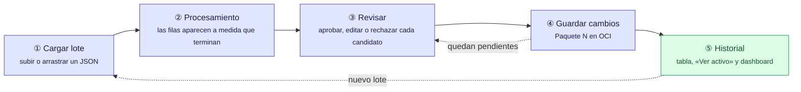

# Ciclo de vida del usuario en la interfaz

- "Guardar cambios" solo se habilita cuando el lote terminó de procesarse y no quedan candidatos pendientes.
- El Historial se puede abrir en cualquier momento desde el encabezado.
