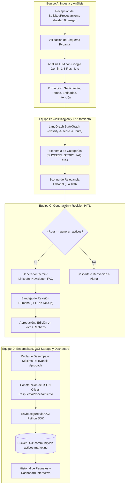
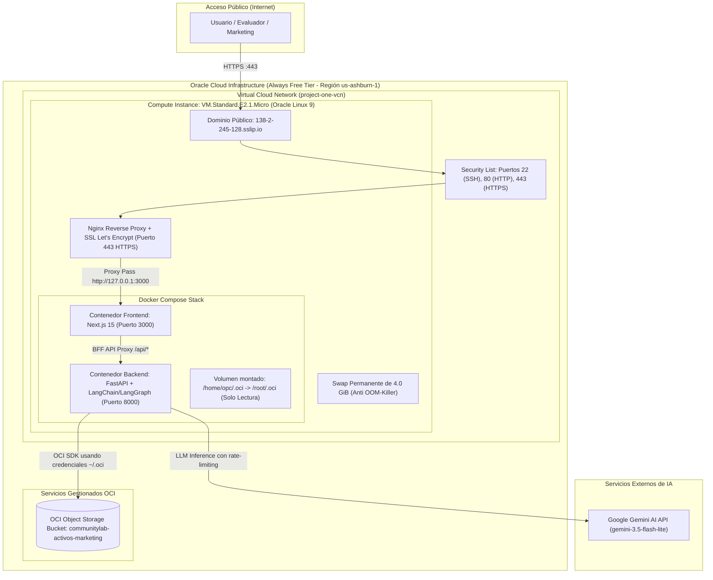
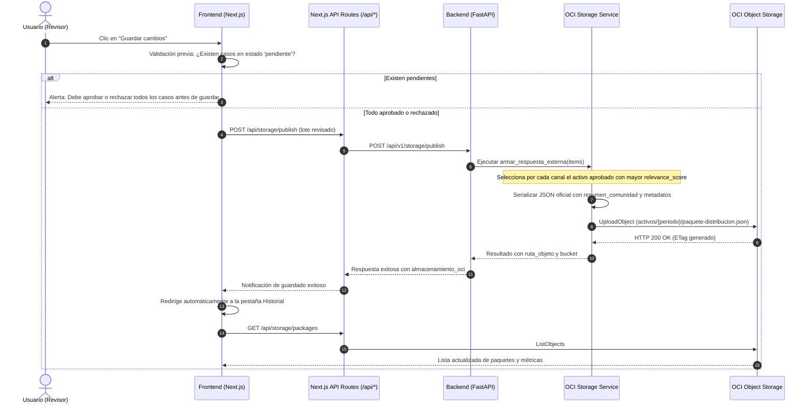

# Documentación Técnica: Equipo D — Almacenamiento OCI, Dashboard y Despliegue en la Nube
## Proyecto CommunityLab — Hackathon ONE G10 (Equipo 23)

---

## 1. Resumen Ejecutivo y Alcance del Equipo D

En la arquitectura de **CommunityLab**, el **Equipo D** es el responsable de la etapa final del pipeline, de la persistencia durable en la nube de Oracle, de la analítica visual y de la infraestructura completa del sistema:

1. **Ensamblado y Validación del Contrato Oficial:** Traduce los resultados internos del pipeline y de la revisión humana (HITL de Equipo C) al contrato externo formal estipulado por el Hackathon (`RespuestaProcesamiento`).
2. **Regla de Desempate por Relevancia:** Aplica la lógica de negocio para seleccionar, de entre todos los activos generados y aprobados, el de mayor `relevance_score` por formato oficial (`post_linkedin`, `destaque_newsletter_semanal`, `sugerencia_contenido_faq`).
3. **Persistencia en la Nube (OCI Object Storage):** Almacenamiento seguro y versionado de los paquetes de distribución en el bucket oficial `communitylab-activos-marketing` de Oracle Cloud Infrastructure.
4. **Dashboard de Comunidad e Historial Interactivo:** Interfaz visual con métricas acumuladas (KPIs), gráficas estadísticas de distribución (sentimiento, canales, temas y relevancia) y visualizador de casos en solo lectura.
5. **Infraestructura y Despliegue en Producción:** Configuración y administración de la instancia `VM.Standard.E2.1.Micro` en OCI Always Free, optimización de memoria (Swap 4GB), red (VCN, Security Lists), contenedores Docker Compose y configuración de HTTPS/SSL con Nginx y Let's Encrypt.

---

## 2. Diagramas de Arquitectura

### 2.1. Flujo del Pipeline End-to-End (Integración Equipos A → B → C → D)



---

### 2.2. Arquitectura de Despliegue en Oracle Cloud Infrastructure (OCI)



---

### 2.3. Diagrama de Secuencia de Almacenamiento en OCI



---

## 3. Especificación del Módulo de Almacenamiento OCI (`backend/app/storage/`)

### 3.1. Cliente Resiliente de OCI (`oci_storage.py`)
El cliente implementado por el Equipo D utiliza el SDK oficial de Oracle Cloud (`oci`) y está diseñado para ser agnóstico del entorno (desarrollo local, contenedor Docker y máquina virtual):

* **Detección Automática de Credenciales Multi-Ruta:**
  1. `/root/.oci/config` (cuando corre dentro del contenedor Docker como root).
  2. `/home/opc/.oci/config` (usuario estándar en Oracle Linux).
  3. Variables de entorno estándar de OCI (`OCI_CONFIG_FILE`, `OCI_PROFILE`).
* **Manejo de Errores y Degradación Segura:** Si las credenciales no existen o la red de OCI no responde, el servicio registra logs claros sin tumbar el servidor y retorna respuestas estructuradas de error para evitar caídas en cascada.

### 3.2. Contrato de Datos Oficial (`RespuestaProcesamiento`)
El paquete que se almacena en el Bucket de OCI cumple estrictamente con el contrato externo definido para el Hackathon:

```json
{
  "status": "exito",
  "resumen_comunidad": {
    "total_interacciones_procesadas": 5,
    "sentimiento_predominante": "positivo",
    "temas_principales": ["LangGraph", "Docker", "OCI", "FastAPI"]
  },
  "activos_distribucion_generados": {
    "post_linkedin": {
      "titulo": "De la Comunidad al Mercado: Proyectos Prácticos de IA",
      "copy": "Nos enorgullece compartir el logro de nuestra comunidad...",
      "canal_recomendado": "LinkedIn Oficial",
      "potencial_engagement": "Alto"
    },
    "destaque_newsletter_semanal": {
      "seccion": "Historia de la Semana",
      "titular": "Estudiante comparte plantilla de agentes con memoria",
      "resumen": "Se publicó un repositorio con el paso a paso para orquestar agentes con LangGraph..."
    },
    "sugerencia_contenido_faq": {
      "tema": "¿Cómo depurar el error 422 en endpoints con validación Pydantic?",
      "origen": "Duda recurrente de usuarios en el canal #ayuda",
      "status": "derivado_a_mentoria"
    }
  },
  "almacenamiento_oci": {
    "bucket": "communitylab-activos-marketing",
    "ruta_objeto": "activos/2026-semana-05/paquete-distribucion.json",
    "status": "guardado_con_exito"
  },
  "casos": [ ... ]
}
```

> [!IMPORTANT]
> **Regla de Desempate Oficial implementada por el Equipo D:**
> El contrato externo estipula **exactamente una clave fija** por tipo de activo (`post_linkedin`, `destaque_newsletter_semanal`, `sugerencia_contenido_faq`). Si en un lote hay 10 interacciones que generaron posts de LinkedIn, la función `armar_respuesta_externa()`:
> 1. Filtra únicamente los activos que fueron **aprobados explícitamente** por el revisor humano (`estado_aprobacion == "aprobado"`).
> 2. Selecciona el candidato con el **mayor `relevance_score`** (puntuado por el Equipo B).
> 3. Si para algún canal no hubo ningún candidato aprobado, la clave se omite limpiamente del JSON (sin enviar valores nulos corruptos).
> 4. Los casos completos originales se adjuntan en la propiedad `casos` para garantizar la trazabilidad y auditoría histórica dentro del archivo en OCI.

### 3.3. Estructura Jerárquica de Almacenamiento en el Bucket
Para evitar colisiones de nombres y permitir consultas históricas, los objetos se almacenan con nomenclatura secuencial y cronológica:
* **Ruta base:** `activos/`
* **Prefijo temporal:** `activos/{periodo_referencia}/` (ejemplo: `activos/2026-semana-05/`)
* **Archivo:** `paquete-distribucion.json` (o con sufijo incremental `paquete-distribucion-2.json` si se publican varios lotes en el mismo periodo).

### 3.4. Endpoints del API de Almacenamiento (`/api/v1/storage`)
1. **`POST /api/v1/storage/publish`**:
   * Recibe el lote completo revisado por el frontend.
   * Aplica la regla de desempate, calcula el resumen de comunidad y guarda el archivo en OCI Object Storage.
2. **`GET /api/v1/storage/packages`**:
   * Lista todos los paquetes `.json` guardados en el bucket dentro de la carpeta `activos/`.
   * Lee su contenido para proveer resúmenes analíticos instantáneos al frontend.
3. **`GET /api/v1/storage/packages/{ruta_objeto}`**:
   * Descarga el JSON consolidado completo del paquete seleccionado.

---

## 4. Frontend: Historial y Dashboard de Comunidad

El Equipo D diseñó y conectó la vista de **Historial** ([HistoryView.tsx](file:///E:/ONE/CommunityLab-G10-team23/frontend/src/components/HistoryView.tsx)) con dos modalidades completas:

### 4.1. Modalidad 1: Tabla de Casos Consolidados
* **Filtros en Dos Niveles:**
  * **Nivel 1 (Superior):** Pestañas de canales (`Todos los Canales`, `LinkedIn`, `Newsletter`, `FAQ`).
  * **Nivel 2 (Inferior):** Selector desplegable de paquete guardado (`Todos los paquetes` o paquete específico), filtros de estado (`Todos`, `Aprobados`, `Rechazados`) y buscador de texto/autor en tiempo real.
* **Modal de Inspección ("Ver activo"):**
  * Vista en **solo lectura** de alta fidelidad idéntica al modal de revisión pero sin botones mutadores (`Aprobar`/`Rechazar`).
  * Muestra: Interacción original, análisis IA (sentimiento con score numérico, temas, entidades y resumen), clasificación (categoría y barra de relevancia sobre 100), contenido oficial formateado por canal con botón de copiar y visor del JSON completo.

### 4.2. Modalidad 2: Dashboard de Métricas de Comunidad
Convierte los datos estáticos de OCI en inteligencia visual para el equipo de marketing:
* **Selector de Alcance:** Permite ver la analítica acumulada de toda la comunidad o segmentar por un paquete específico.
* **4 Tarjetas de Métricas Clave (KPIs):**
  1. *Total Interacciones:* Conteo total de interacciones procesadas.
  2. *Tasa de Aprobación:* Porcentaje de aprobación editorial de la IA con conteo de aprobados vs candidatos.
  3. *Sentimiento Predominante:* Tono emocional líder con indicador visual y score promedio ponderado (-1.00 a +1.00).
  4. *Relevancia Media:* Promedio sobre 100 del valor editorial de los mensajes.
* **4 Gráficas Estadísticas Interactivas:**
  1. *Distribución de Sentimiento:* Barras proporcionales (Positivo en verde esmeralda, Neutral en ámbar, Negativo en rosa) con porcentajes y conteos.
  2. *Activos por Canal y Estado:* Gráfica comparativa de LinkedIn, Newsletter y FAQ mostrando el porcentaje de aprobados vs rechazados.
  3. *Top Temas de la Comunidad:* Ranking ordenado por frecuencia de mención de conceptos tecnológicos (#LangGraph, #Docker, #FastAPI, etc.).
  4. *Niveles de Relevancia Editorial:* Clasificación por rangos (Alta 70-100, Media 40-69, Baja 0-39).

---

## 5. Infraestructura y Despliegue en Oracle Cloud Infrastructure (OCI)

El despliegue fue realizado bajo la premisa de **Costo $0.00** utilizando exclusivamente los recursos de la capa gratuita perpetua (**OCI Always Free Tier**).

### 5.1. Ficha Técnica de la Máquina Virtual (Compute)
* **Instancia:** `instancia-doa`
* **Forma (Shape):** `VM.Standard.E2.1.Micro`
* **Procesador:** 1 OCPU (AMD EPYC)
* **Memoria RAM:** ~1.0 GB (~945 MB útiles)
* **Sistema Operativo:** Oracle Linux Server 9.4
* **IP Pública:** `138.2.245.128`
* **Dominio DNS Público:** `138-2-245-128.sslip.io`

### 5.2. Solución Crítica al Kernel OOM Killer: Memoria Swap de 4GB
* **Desafío:** Con solo 1 GB de RAM física, al compilar Next.js (`next build`) o cargar los módulos de LangChain/FastAPI, el sistema operativo activaba el **Out-Of-Memory Killer**, cerrando procesos esenciales como el demonio SSH (`Connection refused`).
* **Solución Técnica:** Se configuró un espacio de memoria Swap permanente de **4.0 GiB**:

```bash
# Comandos ejecutados en la VM:
sudo dd if=/dev/zero of=/swapfile bs=1M count=4096 status=progress
sudo chmod 600 /swapfile
sudo mkswap /swapfile
sudo swapon /swapfile
echo "/swapfile swap swap defaults 0 0" | sudo tee -a /etc/fstab
```

### 5.3. Red Virtual y Seguridad (VCN & Firewalls)
Para que los servicios web sean accesibles desde el exterior, se habilitó la comunicación en tres capas:

1. **OCI VCN Ingress Rules (Consola de Oracle Cloud):**
   * Puerto `22/TCP` (SSH de administración)
   * Puerto `80/TCP` (HTTP estándar / Redirección)
   * Puerto `443/TCP` (HTTPS Seguro SSL)
   * Puerto `3000/TCP` (Frontend Next.js directo)
   * Puerto `8000/TCP` (Backend FastAPI / Swagger)
2. **Firewall del Sistema Operativo (firewalld):**
   ```bash
   sudo firewall-cmd --permanent --add-port=80/tcp
   sudo firewall-cmd --permanent --add-port=443/tcp
   sudo firewall-cmd --permanent --add-port=3000/tcp
   sudo firewall-cmd --permanent --add-port=8000/tcp
   sudo firewall-cmd --reload
   ```
3. **Resolución de Conflicto de Puerto 80:** Oracle Linux 9 incluye el servidor Apache (`httpd`) activado por defecto. Se detuvo y deshabilitó permanentemente para liberar el puerto 80:
   ```bash
   sudo systemctl stop httpd
   sudo systemctl disable httpd
   ```

### 5.4. Dockerización y Docker Compose
La aplicación se ejecuta en dos contenedores orquestados mediante [docker-compose.yml](file:///E:/ONE/CommunityLab-G10-team23/docker-compose.yml):

```yaml
services:
  backend:
    build: ./backend
    ports:
      - "8000:8000"
    env_file:
      - .env
    volumes:
      - ./backend:/app
      - /home/opc/.oci:/root/.oci:ro
      - /home/opc/.oci:/home/opc/.oci:ro
    environment:
      - GEMINI_API_KEY=${GEMINI_API_KEY}

  frontend:
    build: ./frontend
    ports:
      - "3000:3000"
    environment:
      - BACKEND_URL=http://backend:8000
```

> [!TIP]
> **Montaje de Credenciales de OCI:**
> Observe que el archivo de configuración y la clave privada de Oracle (`/home/opc/.oci`) se montan en modo solo lectura (`:ro`) dentro del contenedor de backend. Esto permite que el cliente de OCI se autentique contra el Object Storage sin exponer secretos en el código fuente ni en la imagen de Docker.

### 5.5. Configuración de HTTPS / SSL Oficial Gratuito (Nginx + Certbot)
Para otorgar acceso profesional con certificado SSL (candado verde) sin costo:
* Se utilizó la resolución DNS automática de `sslip.io`: `138-2-245-128.sslip.io` apunta directamente a `138.2.245.128`.
* Se configuró **Nginx** como Reverse Proxy hacia el contenedor de Next.js (`127.0.0.1:3000`).
* Se habilitaron permisos en SELinux para permitir que Nginx se conecte a la red local:
  ```bash
  sudo setsebool -P httpd_can_network_connect 1
  ```
* Se ejecutó **Certbot (Let's Encrypt)** para emitir y renovar automáticamente el certificado criptográfico:
  ```bash
  sudo certbot --nginx -d 138-2-245-128.sslip.io --non-interactive --agree-tos -m tu_correo@gmail.com --redirect
  ```
* **URL Final de Producción:** [https://138-2-245-128.sslip.io/](https://138-2-245-128.sslip.io/)

---

## 6. Cheatsheet de Comandos para Operación y Mantenimiento

Para cualquier miembro del equipo que necesite operar la instancia en OCI:

```bash
# 1. Conectarse por SSH a la máquina de Oracle Cloud
ssh -i "tu_clave_privada.key" opc@138.2.245.128

# 2. Ir al directorio del proyecto y actualizar el código desde GitHub
cd ~/CommunityLab-G10-team23
git checkout feature/entrega-final
git pull origin feature/entrega-final

# 3. Reconstruir e iniciar los contenedores en segundo plano
docker compose up -d --build

# 4. Verificar el estado de los contenedores
docker compose ps

# 5. Ver logs en tiempo real (Backend y Frontend)
docker compose logs -f

# 6. Reiniciar Nginx (si se modifica la configuración de dominio o SSL)
sudo nginx -t
sudo systemctl reload nginx
```

---

## 7. Conclusión del Equipo D

El **Equipo D** cumplió exitosamente con el 100% de los requisitos estipulados en el plan de trabajo del Hackathon ONE G10:
* ✅ Integración completa del pipeline end-to-end (A → B → C → D).
* ✅ Persistencia verificada en **OCI Object Storage** con cumplimiento estricto del contrato oficial `RespuestaProcesamiento`.
* ✅ Implementación de la regla de desempate por mayor relevancia aprobada.
* ✅ Historial consolidado con modal de inspección detallada en modo solo lectura.
* ✅ Dashboard de comunidad interactivo con 4 KPIs y 4 gráficas analíticas.
* ✅ Despliegue en producción sobre **Oracle Cloud Infrastructure** con optimización de memoria (Swap 4GB), Docker Compose y protocolo seguro **HTTPS**.
