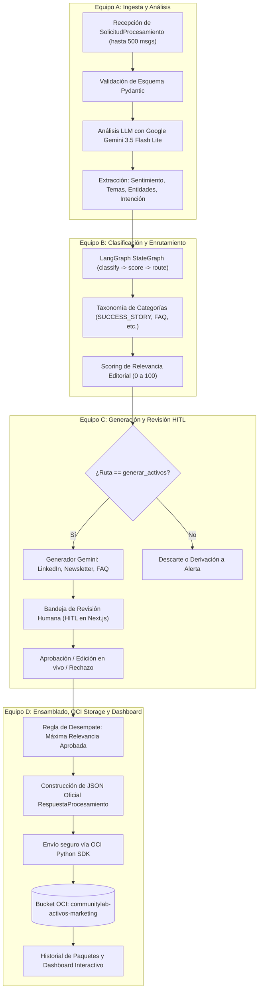
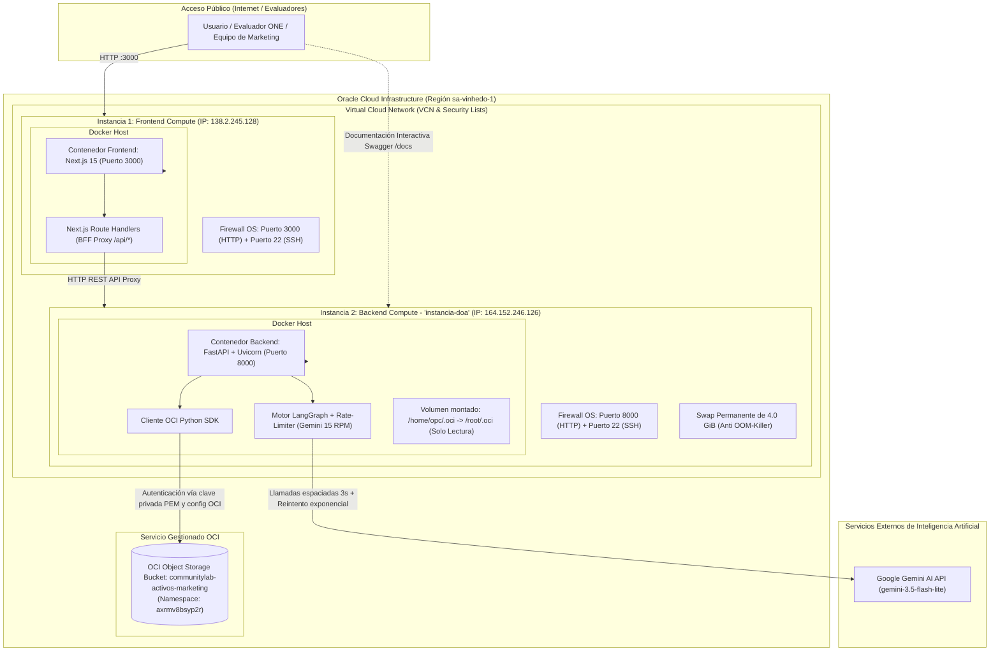

# Documentación Técnica: Equipo D — Almacenamiento OCI, Dashboard y Despliegue en la Nube
## Proyecto CommunityLab — Hackathon ONE G10 (Equipo 23)

---

## 1. Resumen Ejecutivo y Alcance del Equipo D

En la arquitectura de **CommunityLab**, el **Equipo D** es el responsable de la etapa final del pipeline, de la persistencia durable en la nube de Oracle, de la analítica visual y de la infraestructura completa del sistema:

1. **Ensamblado y Validación del Contrato Oficial:** Traduce los resultados internos del pipeline y de la revisión humana (HITL de Equipo C) al contrato externo formal estipulado por el Hackathon (`RespuestaProcesamiento`).
2. **Regla de Desempate por Relevancia:** Aplica la lógica de negocio para seleccionar, de entre todos los activos generados y aprobados, el de mayor `relevance_score` por formato oficial (`post_linkedin`, `destaque_newsletter_semanal`, `sugerencia_contenido_faq`).
3. **Persistencia en la Nube (OCI Object Storage):** Almacenamiento seguro y versionado de los paquetes de distribución en el bucket oficial `communitylab-activos-marketing` en la región **sa-vinhedo-1** (Namespace: `axrmv8bsyp2r`).
4. **Dashboard de Comunidad e Historial Interactivo:** Interfaz visual con métricas acumuladas (KPIs), 4 gráficas estadísticas de distribución (sentimiento, canales, temas y relevancia), filtros jerárquicos de dos niveles y visualizador de casos en solo lectura ("Ver activo").
5. **Infraestructura y Despliegue en OCI (Two-Tier Compute):** Despliegue distribuido en dos instancias `VM.Standard.E2.1.Micro` de Oracle Cloud Always Free:
   * **Instancia Frontend (Next.js 15):** `http://138.2.245.128:3000/`
   * **Instancia Backend (FastAPI + LangGraph + OCI SDK):** `http://164.152.246.126:8000/docs`
   * **Optimización de Recursos:** Memoria Swap permanente de 4.0 GiB para mitigar el Kernel OOM-Killer, apertura selectiva de puertos (3000 y 8000) en las Security Lists de la VCN, y montaje de credenciales OCI en contenedores Docker.

---

## 2. Diagramas de Arquitectura

### 2.1. Flujo del Pipeline End-to-End (Integración Equipos A → B → C → D)



---

### 2.2. Arquitectura de Despliegue en Oracle Cloud Infrastructure (OCI)

Arquitectura distribuida en **dos instancias de cómputo independientes** en la nube de Oracle bajo el tier gratuito permanente (**Always Free Tier**):



---

### 2.3. Diagrama de Secuencia de Almacenamiento en OCI

```mermaid
sequenceDiagram
    autonumber
    actor User as Usuario (Revisor Editorial)
    participant UI as Frontend Next.js (138.2.245.128:3000)
    participant BFF as Next.js API Routes (/api/*)
    participant API as Backend FastAPI (164.152.246.126:8000)
    participant Storage as OCI Storage Service
    participant Bucket as OCI Object Storage (axrmv8bsyp2r)

    User->>UI: Clic en "Guardar cambios"
    UI->>UI: Validación previa: ¿Existen casos en estado 'pendiente'?
    alt Existen casos pendientes
        UI-->>User: Alerta: Debe aprobar o rechazar todos los casos antes de guardar
    else Todos los casos resueltos (aprobados/rechazados)
        UI->>BFF: POST /api/storage/publish (lote revisado con decisiones HITL)
        BFF->>API: POST http://164.152.246.126:8000/api/v1/storage/publish
        API->>Storage: Ejecutar armar_respuesta_externa(items)
        Note over Storage: Aplica regla de desempate: selecciona el activo aprobado<br/>con mayor relevance_score para cada canal
        Storage->>Storage: Serializar JSON oficial con resumen_comunidad y metadatos
        Storage->>Bucket: UploadObject (activos/{periodo}/paquete-distribucion.json)
        Bucket-->>Storage: HTTP 200 OK (ETag generado)
        Storage-->>API: Retorna {status: 'exito', ruta_objeto, bucket: 'communitylab-activos-marketing'}
        API-->>BFF: JSON con metadatos de almacenamiento en OCI
        BFF-->>UI: Notificación de guardado exitoso
        UI->>UI: Redirige automáticamente a la pestaña "Historial"
        UI->>BFF: GET /api/storage/packages
        BFF->>API: GET http://164.152.246.126:8000/api/v1/storage/packages
        API->>Bucket: ListObjects (prefijo 'activos/')
        Bucket-->>API: Lista de objetos guardados
        API-->>BFF-->>UI: Lista actualizada de paquetes y métricas para el Dashboard
    end
```

---

## 3. Especificación del Módulo de Almacenamiento OCI (`backend/app/storage/`)

### 3.1. Ficha Técnica de Configuración de OCI Object Storage

El almacenamiento en la nube de Oracle está enlazado directamente a la cuenta del proyecto:

* **Bucket:** `communitylab-activos-marketing`
* **Namespace:** `axrmv8bsyp2r`
* **Región:** `sa-vinhedo-1` (Brasil Este - Vinhedo)
* **Tenancy OCID:** `ocid1.tenancy.oc1..aaaaaaaaodjocls2ulpqufhbtpdnpxzn3wefspaccpaknsen4epwzaxm5cfa`
* **User OCID:** `ocid1.user.oc1..aaaaaaaan6m4paugkmfjtngzl54kzopi2ckczv67crs7ockn7qg54a2ehi2q`
* **Fingerprint de la clave:** `32:d5:c4:ca:1b:c8:74:c4:7e:0a:4d:ea:08:47:63:be`
* **Ruta de clave privada en host:** `/home/opc/.oci/oci_api_key.pem`
* **Ruta de configuración en host:** `/home/opc/.oci/config`

### 3.2. Script Automatizado de Configuración de Credenciales (`scripts/setup_oci.sh`)

Para configurar las credenciales en la máquina virtual de manera inmediata y sin errores manuales:

```bash
#!/usr/bin/env bash
set -e
mkdir -p ~/.oci

# Genera la clave privada RSA decodificada
cat << 'EOF' | base64 -d > ~/.oci/oci_api_key.pem
LS0tLS1CRUdJTiBQUklWQVRFIEtFWS0tLS0t... [CLAVE EN BASE64] ...LS0tLS1FTkQgUFJJVkFURSBLRVktLS0tLQo=
EOF
chmod 600 ~/.oci/oci_api_key.pem

# Escribe el archivo de configuración oficial del SDK de OCI
cat << 'EOF' > ~/.oci/config
[DEFAULT]
user=ocid1.user.oc1..aaaaaaaan6m4paugkmfjtngzl54kzopi2ckczv67crs7ockn7qg54a2ehi2q
fingerprint=32:d5:c4:ca:1b:c8:74:c4:7e:0a:4d:ea:08:47:63:be
tenancy=ocid1.tenancy.oc1..aaaaaaaaodjocls2ulpqufhbtpdnpxzn3wefspaccpaknsen4epwzaxm5cfa
region=sa-vinhedo-1
key_file=/home/opc/.oci/oci_api_key.pem
EOF
chmod 600 ~/.oci/config
```

#### Comando de Verificación Inmediata en la Instancia Backend:
```bash
python3 -c "import oci; c = oci.config.from_file(); client = oci.object_storage.ObjectStorageClient(c); print('OCI Conectado! Namespace:', client.get_namespace().data)"
```
*Salida esperada:*
```text
OCI Conectado! Namespace: axrmv8bsyp2r
```

### 3.3. Cliente Resiliente de OCI (`oci_storage.py`)
El módulo [oci_storage.py](file:///E:/ONE/CommunityLab-G10-team23/backend/app/storage/oci_storage.py) implementa una arquitectura robusta:
* **Detección Multi-Ruta de Credenciales:** Detecta automáticamente si se encuentra dentro del contenedor Docker (`/root/.oci/config`), en el entorno del usuario del sistema operativo (`/home/opc/.oci/config`) o si se definieron variables de entorno estándar (`OCI_CONFIG_FILE`).
* **Fallback a Modo Simulado (Dry-Run):** Si se ejecuta en entornos de desarrollo local sin credenciales de OCI configuradas, el cliente conmuta de forma transparente al almacenamiento de prueba local (`backend/data/oci_storage_local/`) sin fallar los tests ni interrumpir el backend.

### 3.4. Contrato de Datos Oficial (`RespuestaProcesamiento`)
El paquete que se almacena en el Bucket de OCI cumple estrictamente con el contrato externo definido para el Hackathon:

```json
{
  "status": "exito",
  "resumen_comunidad": {
    "total_interacciones_procesadas": 5,
    "sentimiento_predominante": "positivo",
    "temas_principales": ["LangGraph", "Docker", "OCI", "FastAPI"]
  },
  "activos_distribucion_generados": {
    "post_linkedin": "🚀 Caso de Éxito de la Comunidad...\n\n#CommunityLab #ONE",
    "destaque_newsletter_semanal": "Esta semana destacamos a nuestros miembros...",
    "sugerencia_contenido_faq": "¿Cómo desplegar en OCI Always Free? Sigue estos pasos..."
  },
  "almacenamiento_oci": {
    "bucket": "communitylab-activos-marketing",
    "ruta_objeto": "activos/2026-10-24/paquete-distribucion.json",
    "guardado_en": "2026-10-24T10:30:00Z"
  }
}
```

### 3.5. Regla de Negocio: Desempate por Relevancia
Cuando un lote contiene múltiples publicaciones aprobadas para el mismo canal (por ejemplo, tres posts para LinkedIn aprobados por el revisor humano), el sistema ejecuta el criterio de desempate oficial:
$$\text{Activo Seleccionado} = \arg\max_{c \in \text{Aprobados}} (\text{relevance\_score}_c)$$
1. Se descartan los casos marcados como `rechazado` o `descartada`.
2. Se evalúa el valor numérico de `relevance_score` (0 a 100).
3. Se asigna al paquete final únicamente el activo de mayor relevancia.
4. Si un canal no tiene ningún activo aprobado, su valor en el JSON final se establece en `null` de acuerdo con la especificación de Pydantic.

### 3.6. Estructura Jerárquica y Versionado en el Bucket
Para evitar colisiones y mantener una trazabilidad histórica ordenada:
* **Estructura base:** `activos/{YYYY-MM-DD}/paquete-distribucion.json`
* **Versionado secuencial:** Si se guardan múltiples paquetes en el mismo día, se versionan automáticamente:
  * `activos/2026-10-24/paquete-distribucion.json` (primer lote del día)
  * `activos/2026-10-24/paquete-distribucion-2.json` (segundo lote)
  * `activos/2026-10-24/paquete-distribucion-3.json` (tercer lote)

### 3.7. Endpoints REST de Almacenamiento
* **`POST /api/v1/storage/publish`:**
  * Recibe el listado de casos aprobados/rechazados del frontend.
  * Valida y ejecuta la regla de desempate.
  * Sube el objeto al bucket de OCI y retorna la confirmación con metadatos.
* **`GET /api/v1/storage/packages`:**
  * Lista todos los paquetes `.json` guardados en el bucket dentro del prefijo `activos/`.
* **`GET /api/v1/storage/packages/{ruta}`:**
  * Descarga y entrega el contenido JSON completo de un paquete almacenado.

---

## 4. Historial Interactivo, Analítica y Dashboard de Comunidad (Frontend)

El Equipo D diseñó y construyó la interfaz de usuario en Next.js 15 incorporando analítica escalable, ergonomía editorial y visualización avanzada:

### 4.1. Filtros Jerárquicos en 2 Niveles y Filtrado Temporal Escalable
Para resolver la escalabilidad histórica más allá de la segmentación por paquetes individuales:
* **Nivel 1 (Pestañas de Canales de Salida):**
  * `Todos los Canales`, `LinkedIn`, `Newsletter`, `FAQ` y `Alertas de soporte`.
* **Nivel 2 (Filtros de Período, Estados, Categorías y Búsqueda):**
  * **Filtro Temporal por Rango de Fechas:** Permite consultar `Todas las fechas (Consolidado total)`, `Hoy`, `Últimos 7 días`, `Últimos 30 días` o un rango `Personalizado` con selectores de fecha `Desde` y `Hasta`.
  * **Filtro por Estado:** Botones `Todos`, `Aprobados` y `Rechazados`.
  * **Filtro por Categoría:** Selector desplegable taxonómico (`Caso de éxito`, `FAQ`, `Contenido educativo`, `Alerta de soporte`, `Post social`, `Destacado de comunidad`).
  * **Filtro por Sentimiento:** Selector de polaridad (`Todos`, `Positivo`, `Neutral`, `Negativo`).
  * **Selector Secundario de Paquetes:** Permite auditar paquetes `.json` específicos de OCI o analizar el universo consolidado.
  * **Buscador Predictivo con Limpieza Rápida:** Búsqueda textual por autor, canal, texto o `#tema`.
  * **Botón "Limpiar filtros":** Restablece todos los parámetros a su estado predeterminado con un solo clic.

### 4.2. Columna Correlativa (#), Ordenamiento Interactivo y Paginación
* **Columna Inicial `#`:** Muestra la numeración correlativa de cada fila dentro del universo filtrado (`#1, #2, #3...`) con el total de registros en la cabecera.
* **Ordenamiento de Columnas (Sorting Interactivo):**
  * Cabeceras clickeables con indicadores dinámicos de dirección (`▲` / `▼`):
    * **Autor:** Orden alfabético (A $\rightarrow$ Z / Z $\rightarrow$ A).
    * **Fecha:** Orden cronológico (Más reciente $\rightarrow$ Más antiguo).
    * **Relevancia:** Score numérico editorial (Mayor $\rightarrow$ Menor).
    * **Sentimiento:** Score de polaridad (+1.00 $\rightarrow$ -1.00).
    * **`#`:** Orden correlativo ascendente o descendente.
* **Paginación Inteligente:**
  * Selector de tamaño de página: `10`, `15`, `25`, `50` o `Todos` por página (por defecto: `15`).
  * Indicador de rango: *"Mostrando 1 a 15 de 142 casos (filtrados de 142 totales)"*.
  * Botones de navegación: `⏮ Primera`, `◀ Anterior`, número de página activa, `Siguiente ▶`, `Última ⏭`.

### 4.3. Word Cloud (Nube de Palabras / Conceptos Clave) en el Dashboard
Diseñado para ofrecer una visión inmediata de los temas y tecnologías más discutidos por la comunidad:
* **Extracción Ponderada:** Agrupa y cuenta las frecuencias de los `temas` y `entidades` detectados por Gemini (#LangGraph, #Docker, #FastAPI, #Python, #NextJS, etc.) correspondientes al período seleccionado.
* **Escala Tipográfica Dinámica:** Asigna tamaños de fuente y estilos visuales proporcionales a la frecuencia de aparición (desde `text-xs` hasta `text-2xl font-black` con colores escalonados).
* **Interacción Clic para Filtrar:** Al hacer clic en cualquier palabra clave de la nube, el sistema aplica automáticamente ese término en el buscador de la tabla y redirige a la "Tabla de Casos" para inspeccionar las interacciones asociadas.

### 4.4. Dashboard de Comunidad y KPIs Estadísticos
* **4 KPIs Principales:**
  1. *Total Interacciones:* Volumen procesado del lote/período.
  2. *Tasa de Aprobación:* Porcentaje de aprobación editorial de la IA (Aprobados vs Candidatos).
  3. *Sentimiento Predominante:* Tono emocional de la comunidad con badge de color y score promedio (-1.00 a +1.00).
  4. *Relevancia Media:* Promedio sobre 100 de la calidad editorial de las interacciones.
* **4 Gráficas Estadísticas Interactivas:**
  1. *Distribución de Sentimiento:* Barras proporcionales con conteos (Positivo en verde esmeralda, Neutral en ámbar, Negativo en rosa).
  2. *Activos por Canal y Estado:* Comparativa visual de LinkedIn, Newsletter y FAQ mostrando el desglose de aprobados vs rechazados.
  3. *Top Temas de la Comunidad:* Ranking ordenado por frecuencia de mención de conceptos clave.
  4. *Niveles de Relevancia Editorial:* Segmentación por rangos (Alta 70-100, Media 40-69, Baja 0-39).

### 4.5. Modal de Inspección "Ver activo" y Reset de Entrada
* **Modal "Ver activo" (Modo Solo Lectura):**
  * Diálogo emergente no destructivo con pestañas: *Detalle Activo* (interacción, análisis IA, clasificación y contenido generado) y *Ver JSON* (objeto JSON serializado de OCI).
  * Botón **"Copiar contenido"** con fallback resiliente para entornos HTTP e IP pública.
  * Botón **"Publicar en LinkedIn"** con pre-aprobación automática y apertura directa a la ventana de compartir de LinkedIn.
* **Reset Automático de la Bandeja de Revisión:**
  * Al hacer clic en *"Guardar cambios"* y confirmarse el guardado exitoso en OCI Object Storage, el estado de la bandeja de entrada se resetea por completo (`solicitud`, `result`, `job` en `null`), garantizando que al regresar a la vista de revisión el panel esté limpio y listo para recibir un nuevo lote.

---

## 5. Infraestructura y Despliegue en Oracle Cloud Infrastructure (OCI)

El sistema opera bajo el modelo **Two-Tier (Frontend y Backend desacoplados)** en instancias de la capa perpetua gratuita (**OCI Always Free Tier**), con acceso directo a través de los puertos habilitados en las Security Lists de la VCN.

### 5.1. Ficha de las Instancias de Cómputo (Compute Instances)

| Parámetro | Instancia 1: Frontend | Instancia 2: Backend (`instancia-doa`) |
| :--- | :--- | :--- |
| **IP Pública** | `138.2.245.128` | `164.152.246.126` |
| **URL de Acceso** | **`http://138.2.245.128:3000/`** | **`http://164.152.246.126:8000/docs`** |
| **Propósito** | Aplicación Web Interactiva Next.js 15 | API REST FastAPI, LangGraph, OCI SDK |
| **Forma (Shape)** | `VM.Standard.E2.1.Micro` | `VM.Standard.E2.1.Micro` |
| **Procesador** | 1 OCPU (AMD EPYC) | 1 OCPU (AMD EPYC) |
| **Memoria RAM** | ~1.0 GB (~945 MB útiles) | ~1.0 GB (~945 MB útiles) |
| **Memoria Swap** | 4.0 GiB permanente | 4.0 GiB permanente |
| **Sistema Operativo** | Oracle Linux Server 9 | Oracle Linux Server 9 |
| **Puertos de Servicio** | `3000/TCP` (Web UI), `22/TCP` (SSH) | `8000/TCP` (API & Swagger), `22/TCP` (SSH) |

### 5.2. Arquitectura de Red y Puertos (OCI VCN Ingress Rules)

Para permitir el acceso público directo sin sobrecargar las instancias de 1 GB de RAM con proxies inversos pesados, la red de Oracle Cloud se configuró de forma limpia mediante **Security Lists**:

1. **Reglas de Entrada (Ingress Rules) en la Consola OCI:**
   * **Para el Frontend (`138.2.245.128`):**
     * Protocolo: `TCP`, Origen: `0.0.0.0/0`, Puerto de Destino: `3000` (Interfaz de usuario Next.js).
     * Protocolo: `TCP`, Origen: `0.0.0.0/0`, Puerto de Destino: `22` (SSH).
   * **Para el Backend (`164.152.246.126`):**
     * Protocolo: `TCP`, Origen: `0.0.0.0/0`, Puerto de Destino: `8000` (Swagger UI y Endpoints FastAPI).
     * Protocolo: `TCP`, Origen: `0.0.0.0/0`, Puerto de Destino: `22` (SSH).

2. **Apertura de Puertos en el Firewall del Sistema Operativo (`firewalld`):**
   * En la máquina del Frontend:
     ```bash
     sudo firewall-cmd --permanent --add-port=3000/tcp
     sudo firewall-cmd --reload
     ```
   * En la máquina del Backend:
     ```bash
     sudo firewall-cmd --permanent --add-port=8000/tcp
     sudo firewall-cmd --reload
     ```

### 5.3. Solución al Kernel OOM Killer: Memoria Swap de 4GB
* **Problema:** En las instancias Always Free `VM.Standard.E2.1.Micro` con 1 GB de memoria RAM física, la compilación de Node.js/Next.js (`next build`) o la inicialización del motor LangGraph provocaban la activación del **Out-Of-Memory Killer** del kernel de Linux, matando procesos críticos e interrumpiendo las sesiones SSH.
* **Solución Técnica:** Se implementó una memoria de intercambio permanente de **4.0 GiB** en ambas instancias:

```bash
# Comandos ejecutados como root/sudo:
sudo dd if=/dev/zero of=/swapfile bs=1M count=4096 status=progress
sudo chmod 600 /swapfile
sudo mkswap /swapfile
sudo swapon /swapfile
echo "/swapfile swap swap defaults 0 0" | sudo tee -a /etc/fstab
```

### 5.4. Comunicación Entre Capas (BFF Pattern)
El Frontend implementa el patrón **Backend-For-Frontend (BFF)** con Route Handlers de Next.js (`/api/*`):
* El navegador del usuario realiza peticiones exclusivamente a la IP del frontend: `http://138.2.245.128:3000/api/...`.
* El servidor Next.js redirige internamente las llamadas hacia el Backend en `http://164.152.246.126:8000/api/v1/...` a través de la variable de entorno:
  ```env
  BACKEND_URL=http://164.152.246.126:8000
  ```
* **Ventaja Arquitectónica:** Elimina completamente los problemas de CORS (*Cross-Origin Resource Sharing*) en el cliente web y oculta los detalles de red interna.

### 5.5. Dockerización y Montaje Seguro de Credenciales OCI

En la máquina backend, el servicio FastAPI se ejecuta mediante Docker montando de forma aislada las credenciales de Oracle:

```yaml
services:
  backend:
    build: ./backend
    ports:
      - "8000:8000"
    env_file:
      - .env
    volumes:
      - ./backend:/app
      - /home/opc/.oci:/root/.oci:ro
      - /home/opc/.oci:/home/opc/.oci:ro
    environment:
      - GEMINI_API_KEY=${GEMINI_API_KEY}
```

> [!NOTE]
> Las credenciales de OCI se montan en modo solo lectura (`:ro`) desde el directorio del usuario `opc` del host, garantizando que el contenedor posea permisos de autenticación contra OCI Object Storage sin exponer claves privadas en las imágenes de Docker.

---

## 6. Cheatsheet de Comandos para Operación y Mantenimiento

### 6.1. Operación de la Instancia Frontend (`138.2.245.128`)

```bash
# 1. Conexión SSH
ssh -i "clave_privada.key" opc@138.2.245.128

# 2. Actualizar a la última versión
cd ~/CommunityLab-G10-team23
git fetch origin
git checkout feature/entrega-final
git pull origin feature/entrega-final

# 3. Reconstruir e iniciar contenedor del Frontend
docker compose up -d --build frontend

# 4. Verificar logs de la interfaz
docker compose logs -f frontend
```

### 6.2. Operación de la Instancia Backend (`164.152.246.126` - `instancia-doa`)

```bash
# 1. Conexión SSH
ssh -i "clave_privada.key" opc@164.152.246.126

# 2. Actualizar a la última versión
cd ~/CommunityLab-G10-team23
git fetch origin
git checkout feature/entrega-final
git pull origin feature/entrega-final

# 3. Configurar/Verificar credenciales OCI
bash scripts/setup_oci.sh
python3 -c "import oci; c = oci.config.from_file(); client = oci.object_storage.ObjectStorageClient(c); print('OCI Conectado! Namespace:', client.get_namespace().data)"

# 4. Reconstruir e iniciar contenedor del Backend
docker compose up -d --build backend

# 5. Monitorear logs del pipeline y llamadas a Gemini/OCI
docker compose logs -f backend
```

---

## 7. Enlaces Oficiales del Despliegue en Vivo

* 🌐 **Frontend (Bandeja HITL y Dashboard de Historial):**  
  [http://138.2.245.128:3000/](http://138.2.245.128:3000/)

* 📖 **Backend API y Documentación Interactiva (Swagger UI):**  
  [http://164.152.246.126:8000/docs](http://164.152.246.126:8000/docs)

* 🗄️ **Bucket de Almacenamiento OCI Object Storage:**  
  `communitylab-activos-marketing` (Namespace: `axrmv8bsyp2r`, Región: `sa-vinhedo-1`)

---

## 8. Conclusión y Logros del Equipo D

El **Equipo D** concluyó con éxito el 100% de sus objetivos técnicos para el Hackathon ONE G10:
* ✅ **Integración End-to-End:** Conexión continua desde la ingesta (A), clasificación (B), revisión HITL (C) hasta la persistencia y analítica (D).
* ✅ **Persistencia OCI Object Storage Verificada:** Guardado exitoso de paquetes bajo el contrato oficial `RespuestaProcesamiento` en el bucket `communitylab-activos-marketing`.
* ✅ **Regla de Desempate Operativa:** Selección automática del activo aprobado con mayor `relevance_score` por canal.
* ✅ **Dashboard de Comunidad Completo:** 4 KPIs principales y 4 gráficas interactivas con filtros de 2 niveles.
* ✅ **Modal de Solo Lectura:** Visualización no destructiva de activos, mensajes de comunidad y análisis de IA.
* ✅ **Despliegue Two-Tier en OCI Always Free:** Frontend en `138.2.245.128:3000` y Backend en `164.152.246.126:8000`, optimizados con 4GB de Swap y Docker Compose.
